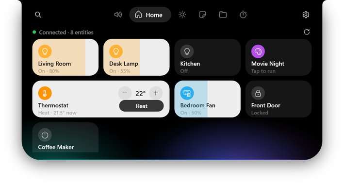
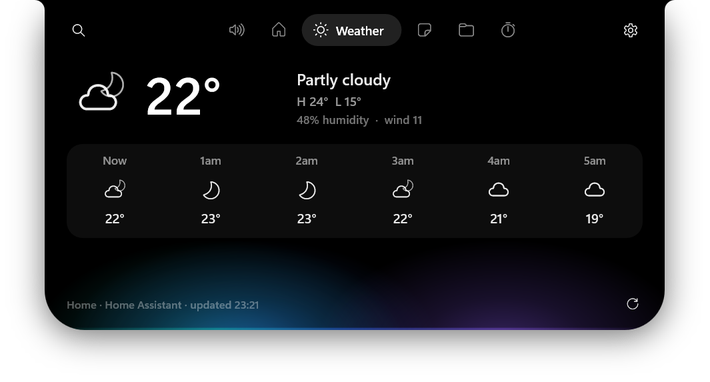
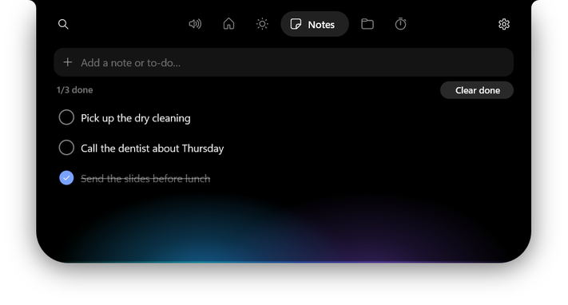
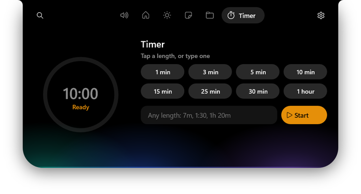
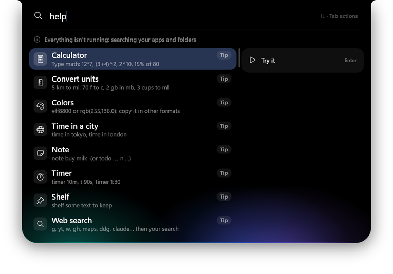

<p align="center">
  <picture>
    <source media="(prefers-color-scheme: dark)" srcset="assets/readme/hello-dark.gif">
    
  </picture>
</p>

<p align="center">
  <picture>
    <source media="(prefers-color-scheme: dark)" srcset="assets/wordmark-dark.png">
    
  </picture>
</p>

<p align="center">
  <a href="https://github.com/Scriptily/isola-notch/releases/latest"><b>Download</b></a> ·
  <a href="#install">Install</a> ·
  <a href="#privacy">Privacy</a> ·
  <a href="CHANGELOG.md">Changelog</a> ·
  <a href="#build-it-yourself">Build</a>
</p>

Isola puts a small black pill at the top of your screen. It shows what's
happening as it happens (a notification, a call, a song, your AirPods
connecting) and opens into a dashboard when you click it. Press `Alt+Space`
and it turns into a launcher.

<p align="center"><picture><source media="(prefers-color-scheme: dark)" srcset="assets/readme/open-dark.gif"></picture></p>

## Light on your PC

Isola is one native program, compiled ahead of time, so there's no .NET or
other runtime to install. It runs as your user and doesn't need administrator
rights.

| At rest, measured on a 16-thread Ryzen laptop | |
|---|---|
| Memory | 30 to 40 MB working set |
| CPU, nothing moving | under 0.1% |
| CPU, music playing (the waveform moves) | about 0.4% |
| Download | 8 MB installer |
| On disk | 19 MB |

It draws frames only while something moves, paced to your display, on the
power-saving GPU. The drifting glow and the waveform are what keep it drawing;
both can be turned off in Settings. A second, smaller process (about 23 MB)
watches over it, so Windows' own notification banners come
back if Isola ever stops (more on that [below](#what-it-changes-in-windows)).

## What it does

### Popups

<p align="center"><picture><source media="(prefers-color-scheme: dark)" srcset="assets/readme/popups-dark.gif"></picture></p>

Notifications with the sending app's icon, calls from your phone through Phone
Link (answer or decline right on the island), track changes, Bluetooth devices
with battery levels, AirPods per bud and case, screens and chargers, the timer,
and volume and Caps Lock changes. A burst of notifications queues up, and
anything past the newest four folds into one summary. A call always goes first.

Isola has its own sounds, made in code: a chime for notifications, a ringtone
for calls, a bell for the timer, and soft tones for devices. Each has a few to
pick from, or you can turn them off.

### Dashboard

| | |
|---|---|
| <picture><source media="(prefers-color-scheme: dark)" srcset="assets/readme/home-dark.png"></picture> | <picture><source media="(prefers-color-scheme: dark)" srcset="assets/readme/weather-dark.png"></picture> |
| <picture><source media="(prefers-color-scheme: dark)" srcset="assets/readme/notes-dark.png"></picture> | <picture><source media="(prefers-color-scheme: dark)" srcset="assets/readme/timer-dark.png"></picture> |

Click the island and scroll sideways through the tabs:

* **Now Playing** for any app's media, with seek, shuffle and repeat, and
  Spotify's own volume once you connect it
* **Sound**: switch the output device and set each app's volume
* **Home**: tiles for the [Home Assistant](https://www.home-assistant.io/)
  lights, scenes, climate, fans and locks you pick. The tab shows up only while
  Home Assistant is reachable
* **Weather** from Home Assistant or [Open-Meteo](https://open-meteo.com/)
* **Notes** and to-dos
* **Shelf**: drop files, text, links or images on the island to park them,
  then drag them back out anywhere
* **Clipboard**: your Windows clipboard history (Win+V)
* **Timer**: tap a length or type one (`7m`, `1:30`, `1h 20m`). It counts down
  in the pill and keeps running through a restart
* **Devices**: Bluetooth on and off, and what's connected

### Search and commands

<p align="center"><picture><source media="(prefers-color-scheme: dark)" srcset="assets/readme/search-dark.gif"></picture></p>

`Alt+Space` (or pull the island down) opens a launcher that answers as you
type: math (`15% of 80`), units (`10 km to mi`), colors (`#ff8800`), the time
in a city, and more than 60 commands for power, Windows settings and your folders.
`note buy milk` adds a note, `timer 10m` starts a timer, `vol 40` sets the
volume, and `g`, `yt`, `w` or `gh` followed by a query search the web. Apps and
files come first. Type `help` to see everything.

<p align="center"><picture><source media="(prefers-color-scheme: dark)" srcset="assets/readme/commands-dark.png"></picture></p>

### Settings

Everything is in Settings (the gear on the dashboard, or the tray icon) and
applies as you change it. Every option is listed with its default in
[`isola.config.example.json`](isola.config.example.json).

Isola steps aside for fullscreen videos and games on its screen, and can slide
out of sight after a few quiet minutes. Bring the pointer to the top edge to
get it back, or press `Ctrl+Alt+I` to hide or show it.

## Works even better with

Both are optional.

* **[Everything](https://www.voidtools.com/)** searches your whole disk
  instantly. With it running, the launcher finds any file. Without it, Isola
  uses its own index of your apps and personal folders.
* **[MagicPods](https://apps.microsoft.com/detail/9P6SKKFKSHKM)** gives exact AirPods battery levels.
  Without it, Isola reads the AirPods' own Bluetooth broadcast, which reports
  battery in 10% steps.

Isola isn't affiliated with Everything, MagicPods, Apple, Spotify or Home
Assistant.

## Install

1. Download `IsolaSetup.exe` from the
   [latest release](https://github.com/Scriptily/isola-notch/releases/latest).
2. Run it. Windows may say it protected your PC, because the setup isn't
   code-signed yet: choose **More info**, then **Run anyway**. Every release's
   notes link a [VirusTotal](https://www.virustotal.com/) scan of the setup and
   list anything it found.
3. The setup shows what it found on your PC, lets you choose options, and
   opens the island.

It installs for your account only (no administrator rights), adds Isola to the
Start menu, starts it when you sign in, and adds an uninstaller to Settings ›
Apps. Run the setup again any time to repair, update or uninstall.

Isola needs Windows 11, or Windows 10 version 2004 or later. It's developed and
tested on Windows 11. On Windows 10 the setup installs the Segoe Fluent Icons
font for your account if it's missing.

Updates install themselves. Isola checks GitHub every six hours and downloads
a new setup only from this repository's releases, then runs it only if the
file's SHA-256 matches both the release notes and GitHub's own record of it.

```powershell
IsolaSetup.exe              # the setup wizard
IsolaSetup.exe /silent      # no questions (add /nolaunch or /noautostart)
IsolaSetup.exe /uninstall   # asks whether to keep your settings
```

## Spotify volume

Windows can't reach the volume slider inside the Spotify app, so Isola uses
Spotify's Web API for it. That needs Spotify Premium and a free developer app
of your own, which takes about a minute. Settings › Spotify walks you through
it:

1. In the [Spotify developer dashboard](https://developer.spotify.com/dashboard),
   create an app.
2. Add the redirect URI `http://127.0.0.1:4381/callback`, tick Web API, and save.
3. Paste the app's Client ID into Settings › Spotify. No client secret is needed.
4. Press Connect and agree in the browser.

Spotify ends these sign-ins after six months. Isola shows the date and puts a
one-click Renew link under the slider in the last two weeks.

## Privacy

Isola has no account, no telemetry and no analytics. It talks only to:

| Service | When | What it sends |
|---|---|---|
| Your Home Assistant | if you set it up | your token, to the address you entered |
| Open-Meteo | weather, if Home Assistant isn't the source | the city or coordinates you entered |
| Spotify | if you connect it | your sign-in, to read and set playback |
| GitHub | update checks, every six hours | nothing about you |

Notifications, media, the clipboard and Bluetooth are read on your PC and stay
there. The Home Assistant token and the Spotify sign-in are encrypted with
Windows' data protection for your account, so a copied config file is useless
anywhere else. The log records which app a notification came from, never who
sent it or what it said, and the detailed log is off unless you turn it on.

Your settings, notes and shelf live in `%LOCALAPPDATA%\Isola`.

## What it changes in Windows

So that each notification appears once, Isola turns off Windows' own banner
and chime for each app while it's showing notifications itself. It writes the
original values to a journal first and puts them back whenever it stops showing
notifications: when you turn the setting off, when a fullscreen app is in front,
on quit, on sign-out, and if Isola crashes or is ended from Task Manager. Apps
you had already silenced stay silenced. You can turn this off in Settings ›
Notifications › Hide Windows' own popups.

It also adds a sign-in task and a Run entry while "Start with Windows" is on.
The uninstaller removes all of it and restores anything still in the journal.

## Build it yourself

You need the [.NET 10 SDK](https://dotnet.microsoft.com/download) and, for the
native build, the Visual Studio Build Tools with the C++ workload.

```powershell
dotnet run                  # run it from the project folder
.\build.ps1                 # run the tests, then build dist\IsolaSetup.exe
cd tests; dotnet run        # just the tests
```

Run from the project folder, Isola keeps its settings and log beside the
project, never registers itself for startup, and never updates itself, so a
development copy and an installed one don't interfere. Only one runs at a time.

The source is C# drawn with Direct2D into a DirectComposition swap chain:
`src/App` (startup, settings, setup wizard), `src/Island` (the state machine,
pages and launcher), `src/Render` (springs and drawing), `src/Services` (media,
audio, Bluetooth, Home Assistant, search, updates) and `src/Shell` (windows,
displays, fullscreen). The tests run the real code against simulated windows,
displays, clocks, Bluetooth and Home Assistant; see
[`tests/README.md`](tests/README.md).

## Known limits

* A window that Task Manager sets to "Always on top" can cover the island.
  Only apps signed for UI Access can sit above those.
* Windows only. There's no macOS or Linux version.

## License

[GPL-3.0](LICENSE). Isola is free, and so is any version of it that someone
else shares.
